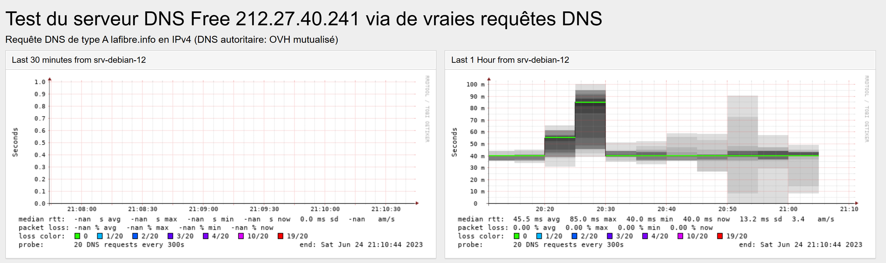

<!-- MASTER-HEADER-START -->
<div align="center">

<a href="https://0xcyberlitech.com/">
  
</a>

<p align="center">
  <a href="https://0xcyberlitech.com/"></a>
  <a href="https://0xcyberlitech.com/soc-rd.html"></a>
  <a href="https://0xcyberlitech.com/jarvis-rd.html"></a>
  <a href="https://github.com/0xCyberLiTech?tab=repositories"></a>
</p>
<p align="center">
  <a href="README.md"></a>
</p>


</div>
<!-- MASTER-HEADER-END -->

<!-- DEBIAN-TRUTH-START -->
> [!IMPORTANT]
>  ** Matrice Officielle Debian — `Debian 12 (Bookworm)` · `Debian 13 (Trixie)` · `Debian 14 (Forky)`**
> - **Sources Officielles Debian.org (`smokeping`) :** `Bookworm (12)` : **`2.7.3-4.1`** &nbsp;·&nbsp; `Trixie (13 — Stable)` : **`2.8.2+ds-1`** &nbsp;·&nbsp; `Forky (14 — Next-Gen)` : **`2.8.2+ds-2`**
> - **Références Officielles :** [Paquet Debian Trixie (`smokeping`)](https://packages.debian.org/trixie/smokeping) &nbsp;·&nbsp; [Paquet Debian Forky (`smokeping`)](https://packages.debian.org/forky/smokeping) &nbsp;·&nbsp; [Documentation Officielle Debian](https://manpages.debian.org/trixie/smokeping/smokeping.1.en.html)
> - **Note d'Ingénierie (Divergence 13 vs 14) :** Sous Debian 13 (Trixie) et Debian 14 (Forky), validez systématiquement la syntaxe des cibles avec `sudo smokeping --check` avant de relancer `smokeping.service`.

<details>
<summary> <b>Afficher les Encarts Ligne de Commande : Debian 13 (Trixie — Stable) vs Debian 14 (Forky — Next-Gen)</b></summary>

####  Profil Production Stable — Commandes pour `Debian 13 (Trixie)`
```bash
# Debian 13 (Trixie) — Smokeping avec fcgiwrap / Apache2 CGI :
sudo apt update && sudo apt install -y smokeping fping apache2
sudo a2enconf smokeping && sudo a2enmod cgid && sudo systemctl restart smokeping apache2
```

####  Profil Anticipation Next-Gen — Commandes pour `Debian 14 (Forky)`
```bash
# Debian 14 (Forky) — Verification des sondes fping & journaux systemd :
sudo smokeping --check
sudo journalctl -u smokeping.service -n 30 --no-hostname
```

</details>
<!-- DEBIAN-TRUTH-END -->

<!-- CIEL-PEDAGOGY-START -->
<details>
<summary> <b>Synthèse d'Architecture, Standards Officiels &amp; Diagnostic (Niveau 1 : Fondamentaux · Niveau 2 : Repères · Niveau 3 : Diagnostic)</b></summary>

- **Niveau 1 — Fondamentaux &amp; Principe d'Architecture :** **Smokeping** mesure en continu la qualité des liaisons réseau (**QoS / SLA**) en émettant des trains de sondes réguliers (`fping`, `DNS`, `HTTP`) afin de modéliser graphiquement le temps de réponse médian (**RTT**), le taux de perte de paquets et la **gigue (*Jitter*)**.
- **Niveau 2 — Repères Officiels (Ports IANA, Fichiers Debian &amp; Commandes de Validation) :** **Ports & Composants :** `ICMP` (Echo Request/Reply) · `TCP 80/443` (Interface Web Apache2 FastCGI) &nbsp;|&nbsp; **Fichiers Debian :** `/etc/smokeping/config.d/Targets`, `/etc/smokeping/config.d/Probes` &nbsp;|&nbsp; **Validation officielle :** `sudo smokeping --check`.
- **Niveau 3 — Diagnostic d'Incidents &amp; Ingénierie Avancée :** **Diagnostic & Architecture :** Sur un graphe Smokeping, la courbe centrale indique la latence médiane, sa couleur reflète le nombre de paquets perdus, et l'ombre grise (*Smoke*) représente la **gigue** (dispersion temporelle entre les paquets d'une même salve, critique pour la téléphonie IP et les flux temps réel).
- **Sources de Vérité Officielles Éditeurs &amp; Standards :** [Documentation Officielle Smokeping (Oetiker)](https://oss.oetiker.ch/smokeping/doc/index.en.html) &nbsp;·&nbsp; [Paquet Officiel Debian Smokeping](https://packages.debian.org/trixie/smokeping)
- **Livres Blancs &amp; 67 Podcasts Audio R&amp;D :** [Portail 0xCyberLiTech](https://0xcyberlitech.com/) &nbsp;·&nbsp; [Livre Blanc SOC Cockpit v5.5](https://0xcyberlitech.com/soc-rd.html) &nbsp;·&nbsp; [Livre Blanc JARVIS Mark-VII](https://0xcyberlitech.com/jarvis-rd.html) &nbsp;·&nbsp; [Blueprint Logiciel &amp; Matériel RTX 5080](https://0xcyberlitech.com/blueprint-jarvis.html)

</details>
<!-- CIEL-PEDAGOGY-END -->




##  01 // SMOKEPING Installation & Configuration.


Les problèmes réseaux et de qualités sont souvent difficiles à comprendre et à analyser, encore faut il les trouver. 

Smokeping peut vous y aider. SmokePing est un logiciel qui vous permet de conserver un historique de la latence de votre réseau.

Il est conçu par Tobi Oetiker, le créateur de MRTG et RRDtool.

SmokePing est prévu pour calculer le RTT (Real Trip Time) entre les différents composants de votre réseau et peut le faire aussi bien avec un basique ping ICMP qu’avec des pings plus spécifiquement adaptés aux protocoles HTTP, SMTP, LDAP, DNS…

Note : Nous partons du principe qu'Apache2 est installé et fonctionnel avant d'installer smokeping.

- Avant de commencer il faut installer et configurer (NTPsec).

[Installer et configurer (NTPsec)](https://github.com/0xCyberLiTech/NTPsec/blob/main/Installer-et-configurer-NTPsec.md)

##  02 // Nous pouvons passer à l'nstallation et configuration.


Mettre à jour l'index des packages.

<!-- CODE-WINDOW-START -->
> [!CAUTION]
> 
>
> ```bash
> apt update && apt upgrade -y
> ```
<!-- CODE-WINDOW-END -->

Installez le package smokeping, mais ignorez les packages recommandés.

<!-- CODE-WINDOW-START -->
> [!CAUTION]
> 
>
> ```bash
> apt install --no-install-recommends smokeping dnsutils curl
> ```
<!-- CODE-WINDOW-END -->

Dans un premier temps, vérifiez les paramètres de la base de données, car vous ne pourrez pas les modifier facilement par la suite.

J'utiliserai les paramètres par défaut, ce qui signifie 20 pings toutes les 5 minutes.

Nous retrouverons nos fichiers de configuration vers :

<!-- CODE-WINDOW-START -->
> [!CAUTION]
> 
>
> ```bash
> /etc/smokeping/config.d/
> ```
<!-- CODE-WINDOW-END -->

<!-- CODE-WINDOW-START -->
> [!CAUTION]
> 
>
> ```bash
> ── config.d
>    ├── Alerts
>    ├── Database
>    ├── General
>    ├── pathnames
>    ├── Presentation
>    ├── Probes
>    ├── Slaves
>    └── Targets
>
> ```
<!-- CODE-WINDOW-END -->

Les fichiers de configuration pris en charge sont déclarés dans le fichier (/etc/smokeping/config).

<!-- CODE-WINDOW-START -->
> [!CAUTION]
> 
>
> ```bash
> cat /etc/smokeping/config.d/
> ```
<!-- CODE-WINDOW-END -->

<!-- CODE-WINDOW-START -->
> [!CAUTION]
> 
>
> ```bash
> @include /etc/smokeping/config.d/General
> @include /etc/smokeping/config.d/Alerts
> @include /etc/smokeping/config.d/Database
> @include /etc/smokeping/config.d/Presentation
> @include /etc/smokeping/config.d/Probes
> @include /etc/smokeping/config.d/Slaves
> @include /etc/smokeping/config.d/Targets
> ```
<!-- CODE-WINDOW-END -->

- Fichier de configuration (/etc/smokeping/config.d/General).

<!-- CODE-WINDOW-START -->
> [!CAUTION]
> 
>
> ```bash
> cat /etc/smokeping/config.d/General
> ```
<!-- CODE-WINDOW-END -->

<!-- CODE-WINDOW-START -->
> [!CAUTION]
> 
>
> ```bash
> # --------------------------------------------------------------------------
> # 0xCyberLiTech
> # Date de création : le 23-06-2023
> # Date de modification : le 24-06-2023
> # Sujet : SMOKEPING - /etc/smokeping/config.d/General
> # --------------------------------------------------------------------------
> *** General ***
>
> owner    = CyberLiTech
> contact  = some@address.nowhere
> mailhost = my.mail.host
> # NOTE: do not put the Image Cache below cgi-bin
> # since all files under cgi-bin will be executed ... this is not
> # good for images.
> cgiurl = http://some.url/smokeping.cgi
> # specify this to get syslog logging
> syslogfacility = local0
> # each probe is now run in its own process
> # disable this to revert to the old behaviour
> # concurrentprobes = no
>
> @include /etc/smokeping/config.d/pathnames
> ```
<!-- CODE-WINDOW-END -->

Mettez à jour l'adresse cgiurl.

(cgiurl = http://some.url/smokeping.cgi) par (cgiurl = http://192.168.0.200/smokeping.cgi).

- Fichier de configuration, (/etc/smokeping/config.d/Alerts).

<!-- CODE-WINDOW-START -->
> [!CAUTION]
> 
>
> ```bash
> cat /etc/smokeping/config.d/Alerts
> ```
<!-- CODE-WINDOW-END -->

<!-- CODE-WINDOW-START -->
> [!CAUTION]
> 
>
> ```bash
> # --------------------------------------------------------------------------
> # 0xCyberLiTech
> # Date de création : le 23-06-2023
> # Date de modification : le 24-06-2023
> # Sujet : SMOKEPING - /etc/smokeping/config.d/Alerts
> # --------------------------------------------------------------------------
> *** Alerts ***
> to = alertee@address.somewhere
> from = smokealert@company.xy
>
> +someloss
> type = loss
> # in percent
> pattern = >0%,*12*,>0%,*12*,>0%
> comment = loss 3 times  in a row
> ```
<!-- CODE-WINDOW-END -->

- Fichier de configuration, (/etc/smokeping/config.d/Database).

<!-- CODE-WINDOW-START -->
> [!CAUTION]
> 
>
> ```bash
> cat /etc/smokeping/config.d/Database
> ```
<!-- CODE-WINDOW-END -->

<!-- CODE-WINDOW-START -->
> [!CAUTION]
> 
>
> ```bash
> # --------------------------------------------------------------------------
> # 0xCyberLiTech
> # Date de création : le 23-06-2023
> # Date de modification : le 24-06-2023
> # Sujet : SMOKEPING - /etc/smokeping/config.d/Database
> # --------------------------------------------------------------------------
> *** Database ***
>
> step     = 300
> pings    = 20
>
> # consfn mrhb steps total
>
> AVERAGE  0.5   1  1008
> AVERAGE  0.5  12  4320
>     MIN  0.5  12  4320
>     MAX  0.5  12  4320
> AVERAGE  0.5 144   720
>     MAX  0.5 144   720
>     MIN  0.5 144   720
> ```
<!-- CODE-WINDOW-END -->

- Fichier de configuration (/etc/smokeping/config.d/Presentation).

<!-- CODE-WINDOW-START -->
> [!CAUTION]
> 
>
> ```bash
> cat /etc/smokeping/config.d/Presentation
> ```
<!-- CODE-WINDOW-END -->

<!-- CODE-WINDOW-START -->
> [!CAUTION]
> 
>
> ```bash
> # --------------------------------------------------------------------------
> # 0xCyberLiTech
> # Date de création : le 23-06-2023
> # Date de modification : le 26-06-2023
> # Sujet : SMOKEPING - /etc/smokeping/config.d/Presentation
> # --------------------------------------------------------------------------
> *** Presentation ***
>
> template = /etc/smokeping/basepage.html
> charset = utf-8
> htmltitle = yes
> graphborders = no
>
> + charts
>
> menu = Charts
> title = The most interesting destinations
>
> ++ stddev
> sorter = StdDev(entries=>4)
> title = Top Standard Deviation
> menu = Std Deviation
> format = Standard Deviation %f
>
> ++ max
> sorter = Max(entries=>5)
> title = Top Max Roundtrip Time
> menu = by Max
> format = Max Roundtrip Time %f seconds
>
> ++ loss
> sorter = Loss(entries=>5)
> title = Top Packet Loss
> menu = Loss
> format = Packets Lost %f
>
> ++ median
> sorter = Median(entries=>5)
> title = Top Median Roundtrip Time
> menu = by Median
> format = Median RTT %f seconds
>
> + overview
>
> width = 600
> height = 50
> range = 10h
>
> + detail
>
> width = 600
> height = 200
> unison_tolerance = 2
>
> "Last 30 minutes" 30m
> "Last 1 Hour"     1h
> "Last 3 Hours"    3h
> "Last 24 Hours"   24h
> "Last 48 Hours"   48h
> "Last 10 Days"    10d
> "Last 30 Days"    30d
> "Last 90 Days"    90d
> "Last 360 Days"   360d
>
> #+ hierarchies
> #++ owner
> #title = Host Owner
> #++ location
> #title = Location
> ```
<!-- CODE-WINDOW-END -->

Nous pouvons constater que nous avons rajouté deux variables de temps supplémentaires.

<!-- CODE-WINDOW-START -->
> [!CAUTION]
> 
>
> ```bash
> "Last 30 minutes" 3m
> "Last 1 Hour"     1h
> ```
<!-- CODE-WINDOW-END -->

- Fichier de configuration, (/etc/smokeping/config.d/Probes).

<!-- CODE-WINDOW-START -->
> [!CAUTION]
> 
>
> ```bash
> cat /etc/smokeping/config.d/Probes
> ```
<!-- CODE-WINDOW-END -->

<!-- CODE-WINDOW-START -->
> [!CAUTION]
> 
>
> ```bash
> # --------------------------------------------------------------------------
> # 0xCyberLiTech
> # Date de création : le 23-06-2023
> # Date de modification : le 26-06-2023
> # Sujet : SMOKEPING - /etc/smokeping/config.d/Probes
> # --------------------------------------------------------------------------
> *** Probes ***
> # --------------------------------------------------------------------------
> # + FPing
> # --------------------------------------------------------------------------
> + FPing
> binary = /usr/bin/fping
>
> ++ FPingNormal
> offset = 0%
>
> ++ FPingLarge
> packetsize = 5000
> offset = 50%
>
> # --------------------------------------------------------------------------
> # + FPing6
> # --------------------------------------------------------------------------
> #+ FPing6
> #binary = /usr/bin/fping6
> #offset = 40%
>
> # --------------------------------------------------------------------------
> # + DNS
> # --------------------------------------------------------------------------
> + DNS
> binary = /usr/bin/dig
> forks = 1
> offset = 70%
>
> # --------------------------------------------------------------------------
> # + Curl
> # --------------------------------------------------------------------------
> + Curl
> # probe-specific variables
> binary = /usr/bin/curl
> step = 60
>
> # a default for this target-specific variable
> urlformat = http://%host/
> ```
<!-- CODE-WINDOW-END -->

- Fichier de configuration, (/etc/smokeping/config.d/Targets).

<!-- CODE-WINDOW-START -->
> [!CAUTION]
> 
>
> ```bash
> cat /etc/smokeping/config.d/Targets
> ```
<!-- CODE-WINDOW-END -->

<!-- CODE-WINDOW-START -->
> [!CAUTION]
> 
>
> ```bash
> # --------------------------------------------------------------------------
> # 0xCyberLiTech
> # Date de création : le 21-06-2023
> # Date de modification : le 23-06-2023
> # Sujet : SMOKEPING - /etc/smokeping/config.d/Targets
> # --------------------------------------------------------------------------
> *** Targets ***
>
> probe = FPingNormal
> menu = Top
> title = Network Latency Grapher
> remark = Welcome to this SmokePing website.
>
> # --------------------------------------------------------------------------
> # ICMP Latency
> # --------------------------------------------------------------------------
> # (srv-linux-01)
> # --------------------------------------------------------------------------
>
> + ICMP-latency-srv-linux-01
> menu = ICMP latency (srv-linux-01)
> title = ICMP latency for (srv-linux-01)
>
> ++ normal
> title = Normal packetsize (56 bytes)
> # remark =
> probe = FPingNormal
> menu = Normal packetsize (56 bytes)
> host = 192.168.50.200
>
> ++ large
> title = Large packetsize (5000 bytes)
> # remark =
> probe = FPingLarge
> menu = Large packetsize (5000 bytes)
> host = 192.168.50.200
>
> # --------------------------------------------------------------------------
> # ICMP Latency
> # --------------------------------------------------------------------------
> # (srv-linux-02)
> # --------------------------------------------------------------------------
> + ICMP-latency-srv-linux-02
> menu = ICMP latency (srv-linux-02)
> title = ICMP latency for (srv-linux-02)
>
> ++ normal
> title = Normal packetsize (56 bytes)
> # remark =
> probe = FPingNormal
> menu = Normal packetsize (56 bytes)
> host = 192.168.50.200
>
> ++ large
> title = Large packetsize (5000 bytes)
> # remark =
> probe = FPingLarge
> menu = Large packetsize (5000 bytes)
> host = 192.168.50.200
>
> # --------------------------------------------------------------------------
> # ICMP Latency
> # --------------------------------------------------------------------------
> # (Freebox Delta)
> # --------------------------------------------------------------------------
> + ICMP-latency-Freebox-Delta
> menu = ICMP latency (Freebox Delta)
> title = ICMP latency (Freebox Delta)
>
> ++ normal
> title = Normal packetsize (56 bytes)
> # remark =
> probe = FPingNormal
> menu = Normal packetsize (56 bytes)
> host = 192.168.1.254
>
> ++ large
> title = Large packetsize (5000 bytes)
> # remark =
> probe = FPingLarge
> menu = Large packetsize (5000 bytes)
>
> host = 192.168.1.254
>
> # --------------------------------------------------------------------------
> # ICMP Latency
> # --------------------------------------------------------------------------
> # (GT-AXE16000)
> # --------------------------------------------------------------------------
> + ICMP-latency-GT-AXE16000
> menu = ICMP latency (GT-AXE16000)
> title = ICMP latency (GT-AXE16000)
>
> ++ normal
> title = Normal packetsize (56 bytes)
> # remark =
> probe = FPingNormal
> menu = Normal packetsize (56 bytes)
> host = 192.168.50.1
>
> ++ large
> title = Large packetsize (5000 bytes)
> # remark =
> probe = FPingLarge
> menu = Large packetsize (5000 bytes)
> host = 192.168.50.1
>
> # --------------------------------------------------------------------------
> # DNS Free
> # --------------------------------------------------------------------------
> # DNSFREE1 ---> 212.27.40.240 ---> dns1.proxad.net.
> # DNSFREE2 ---> 212.27.40.241 ---> dns2.proxad.net.
> # --------------------------------------------------------------------------
> + DNS-Free
> menu = Etat des DNS Free
> title = Etat des DNS Free primaire / secondaire
>
> ++ DNSFREE1
> probe = DNS
> menu = DNS Primaire IPv4 Free
> title = Test du serveur DNS Free 212.27.40.240 via de vraies requêtes DNS
> remark = Requête DNS de type A lafibre.info en IPv4 (DNS autoritaire: OVH mutualisé)
> host = 212.27.40.240
> lookup = lafibre.info
>
> ++ DNSFREE2
> probe = DNS
> menu = DNS Secondaire IPv4 Free
> title = Test du serveur DNS Free 212.27.40.241 via de vraies requêtes DNS
> remark = Requête DNS de type A lafibre.info en IPv4 (DNS autoritaire: OVH mutualisé)
> host = 212.27.40.241
> lookup = lafibre.info
>
> # --------------------------------------------------------------------------
> # DNS Orange
> # --------------------------------------------------------------------------
> # DNSORANGE1 ---> 80.10.246.2   ---> dns-abo-static-a.wanadoo.fr.
> # DNSORANGE2 ---> 80.10.246.129 ---> dns-abo-static-b.wanadoo.fr.
> # --------------------------------------------------------------------------
> + DNS-Orange
> menu = Etat des DNS Orange
> title = Etat des DNS Orange primaire / secondaire
>
> ++ DNSORANGE1
> probe = DNS
> menu = DNS Primaire IPv4 Orange
> title = Test du serveur DNS Orange 80.10.246.2 via de vraies requêtes DNS
> remark = Requête DNS de type A lafibre.info en IPv4 (DNS autoritaire: OVH mutualisé)
> host = 80.10.246.2
> lookup = lafibre.info
>
> ++ DNSORANGE2
> probe = DNS
> menu = DNS Secondaire IPv4 Orange
> title = Test du serveur DNS Orange 80.10.246.129 via de vraies requêtes DNS
> remark = Requête DNS de type A lafibre.info en IPv4 (DNS autoritaire: OVH mutualisé)
> host = 80.10.246.129
> lookup = lafibre.info
>
> # --------------------------------------------------------------------------
> # DNS SFR
> # --------------------------------------------------------------------------
> # DNSSFR1 ---> 109.0.66.10 ---> vip-dns-gp-primary.dns.sfr.net.
> # DNSSFR2 ---> 109.0.66.20 ---> vip-dns-gp-secondary.dns.sfr.net.
> # --------------------------------------------------------------------------
> + DNS-SFR
> menu = Etat des DNS SFR
> title = Etat des DNS SFR primaire / secondaire
>
> ++ DNSSFR1
> probe = DNS
> menu = DNS Primaire IPv4 SFR
> title = Test du serveur DNS SFR 109.0.66.10 via de vraies requêtes DNS
> remark = Requête DNS de type A lafibre.info en IPv4 (DNS autoritaire: OVH mutualisé)
> host = 109.0.66.10
> lookup = lafibre.info
>
> ++ DNSSFR2
> probe = DNS
> menu = DNS Secondaire IPv4 SFR
> title = Test du serveur DNS SFR 109.0.66.20 via de vraies requêtes DNS
> remark = Requête DNS de type A lafibre.info en IPv4 (DNS autoritaire: OVH mutualisé)
> host = 109.0.66.20
> lookup = lafibre.info
>
> # --------------------------------------------------------------------------
> # DNS Bouygues TELECOM
> # --------------------------------------------------------------------------
> # DNSSFR1 ---> 194.158.122.10 ---> nsabo1.bouyguesbox.fr.
> # DNSSFR2 ---> 194.158.122.15 ---> nsabo2.bouyguesbox.fr.
> # --------------------------------------------------------------------------
> + DNS-BOUYGUES-Telecom
> menu = Etat des DNS Bouygues Telecom
> title = Etat des DNS Bouygues Telecom primaire / secondaire
>
> ++ DNSBOUYGUES1
> probe = DNS
> menu = DNS Primaire IPv4 Bouygues Telecom
> title = Test du serveur DNS Bouygues Telecom 194.158.122.10 via de vraies requêtes DNS
> remark = Requête DNS de type A lafibre.info en IPv4 (DNS autoritaire: OVH mutualisé)
> host = 194.158.122.10
> lookup = lafibre.info
>
> ++ DNSBOUYGUES2
> probe = DNS
> menu = DNS Secondaire IPv4 Bouygues Telecom
> title = Test du serveur DNS Bouygues Telecom 194.158.122.15 via de vraies requêtes DNS
> remark = Requête DNS de type A lafibre.info en IPv4 (DNS autoritaire: OVH mutualisé)
> host = 194.158.122.15
> lookup = lafibre.info
>
> # --------------------------------------------------------------------------
> # DNS GOOGLE
> # --------------------------------------------------------------------------
> # DNSGOOGLE1 ---> 8.8.8.8 ---> dns.google.
> # DNSGOOGLE2 ---> 8.8.4.4 ---> dns.google.
> # --------------------------------------------------------------------------
>
> + DNS-Google
> menu = Etat des DNS Google
> title = Etat des DNS Google primaire / secondaire
>
> ++ DNSGOOGLE1
> probe = DNS
> menu = DNS Primaire IPv4 Google
> title = Test du serveur DNS Google 8.8.8.8 via de vraies requêtes DNS
> remark = Requête DNS de type A lafibre.info en IPv4 (DNS autoritaire: OVH mutualisé)
> host = 8.8.8.8
> lookup = lafibre.info
>
> ++ DNSGOOGLE2
> probe = DNS
> menu = DNS Secondaire IPv4 Google
> title = Test du serveur DNS Google 8.8.4.4 via de vraies requêtes DNS
> remark = Requête DNS de type A lafibre.info en IPv4 (DNS autoritaire: OVH mutualisé)
> host = 8.8.4.4
> lookup = lafibre.info
>
> # --------------------------------------------------------------------------
> # HTTP latency
> # --------------------------------------------------------------------------
> # Myhost1 ---> HTTP ---> zimbra.free.fr
> # Myhost2 ---> HTTP ---> web-mail.laposte.ne
> # --------------------------------------------------------------------------
> + HTTP
> menu = HTTP latency
> title = HTTP latency
>
> ++ myhost1
> menu = zimbra.free.fr
> title = HTTP latency for myhost1
> remark = HTTP / zimbra.free.fr
> host = zimbra.free.fr
>
> ++ myhost2
> menu = web-mail.laposte.net
> title = HTTP latency for myhost2
> remark = HTTP / web-mail.laposte.net
> host = web-mail.laposte.net
> ```
<!-- CODE-WINDOW-END -->

Accéder à la console Smokeping :

(http://mon-ip/smokeping/smokeping.cgi) ou (http://FQDN/smokeping/smokeping.cgi)

<!-- MASTER-FOOTER-START -->
<div align="center">


<a href="https://0xcyberlitech.com/">
  
</a>

<p align="center"><a href="https://0xcyberlitech.com/"></a></p>

<sub><b>Architecturé &amp; Forgé par Marc &amp; Antigravity (Google DeepMind)</b> &nbsp;·&nbsp; <a href="https://0xcyberlitech.com/"><b>0xcyberlitech.com</b></a> &nbsp;·&nbsp; <a href="https://0xcyberlitech.com/soc-rd.html">Architecture SOC Cockpit v5.5</a> &nbsp;·&nbsp; <a href="https://0xcyberlitech.com/jarvis-rd.html">Architecture JARVIS Mark-VII</a> &nbsp;·&nbsp; <a href="https://0xcyberlitech.com/blueprint-jarvis.html">Blueprint Matériel RTX 5080</a></sub>

</div>
<!-- MASTER-FOOTER-END -->
